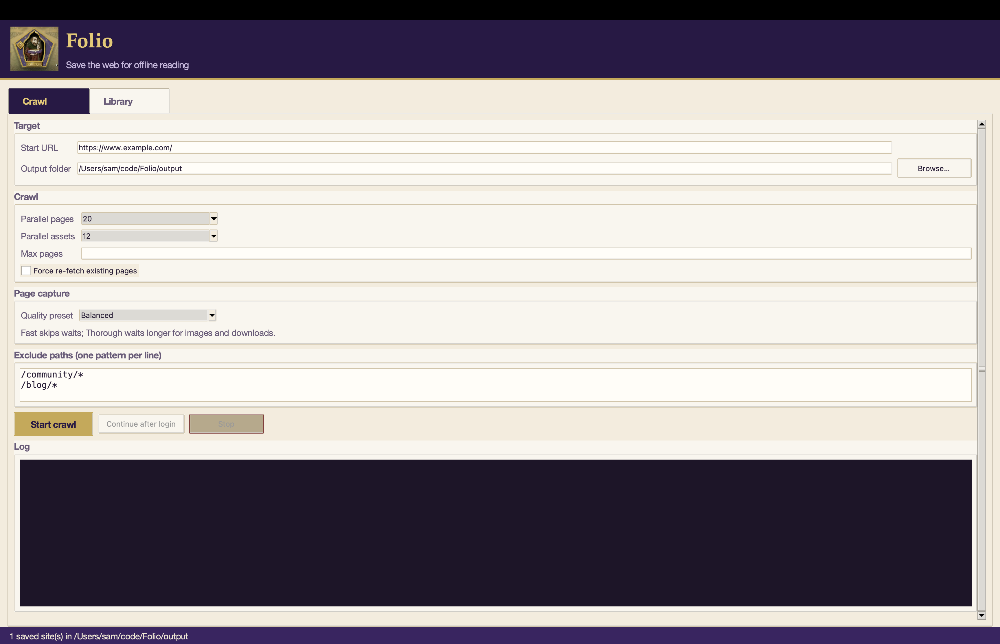

# Folio

**Log in once, save the content, browse it offline.**

Folio crawls a website with Chromium ([Playwright](https://playwright.dev/python/)), waits while you sign in if needed, then saves same-domain pages as static HTML — with CSS, images, fonts, and SVGs pulled down locally. JS is not downloaded.

Only crawl sites you're allowed to access.



## Install

```bash
git clone https://github.com/SamKerr/Folio.git
cd Folio
uv sync --group dev
uv run playwright install chromium
uv run folio doctor
```

## Crawl

```bash
uv run folio crawl https://www.example.com/
```

1. Log in in the browser window if you need to.
2. Press **Enter** in the terminal (or **Continue after login** in the GUI).
3. Pages land in `output/<host>/`.

Preview with a local server (works better than `file://`):

```bash
cd output && python -m http.server 8765
# http://127.0.0.1:8765/www.example.com/
```

Run the same command again to resume — existing pages are skipped. Add `--force` to re-fetch everything.

## GUI

```bash
uv run folio gui
```

Pick a URL, choose a capture preset (Fast / Balanced / Thorough), start the crawl, then open saved sites from the **Library** tab.

macOS app (optional): `bash scripts/build-macos-app.sh` → open `dist/Folio.app`

## Useful flags

```bash
uv run folio crawl https://www.example.com/ \
  --exclude "/forum/*" \
  --concurrency 20 \
  --force
```

`uv run folio crawl --help` for waits, limits, headless mode, and the rest.

## Caveats

- Same hostname only (CDN assets are still downloaded).
- Saved pages are static — no JavaScript, so SPAs and live widgets won't work offline.
- Folio doesn't store your password; it uses your browser session during the crawl.

## Dev

```bash
uv run pytest && uv run ruff check . && uv run mypy
```

Project history: [ROADMAP.md](ROADMAP.md)

## License

MIT — see [LICENSE](LICENSE).
