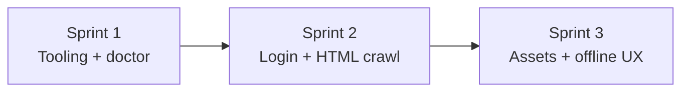

# Folio roadmap

A plausible sprint plan for building Folio from zero to an offline-capable site copier.

---

## Sprint 1 — Setup, tooling, and scaffolding

**Goal:** A installable Python project with dev tooling and a smoke test that proves Playwright works.

### Scope

- Package layout (`src/folio/`, `pyproject.toml`, `uv` lockfile)
- CLI entry point: `folio --version`, `folio --help`, `folio doctor`
- `folio doctor` launches headless Chromium and confirms the stack works
- Dev tooling: pytest, ruff, mypy
- Docs: README setup steps, AGENTS.md project conventions
- `.gitignore` for venv, output, caches

### Tickets

| Ticket | Summary |
|--------|---------|
| T01 | Project packaging and `uv sync` workflow |
| T02 | CLI shell + Playwright doctor smoke test |
| T03 | Test/lint config and developer docs |

### Done criteria

- `uv sync --group dev` succeeds
- `uv run playwright install chromium` documented
- `uv run folio doctor` passes
- `uv run pytest` and `uv run ruff check .` pass

### Out of scope

- Crawling, link discovery, HTML persistence
- CI (optional follow-up)
- GUI or macOS app bundle

---

## Sprint 2 — Login, same-domain crawl, HTML snapshot

**Goal:** Given a start URL, open a real browser, let the user log in, then crawl every same-host page and save rendered HTML to disk.

### Scope

- `folio crawl <url>` opens **headed** Chromium on the target
- User logs in manually, confirms with **Enter** in the terminal (`--skip-login-wait` for automation)
- BFS crawl via `<a href>` discovery; stay on **same hostname** as the root URL
- Map URLs to `output/<host>/path/to/page.html`
- `--max-pages`, `--delay`, `--exclude` path globs, `--force` re-fetch
- Resume: skip pages whose HTML file already exists
- Parallel page workers (default 20 tabs)
- Unit tests with mocked Playwright (no live network in CI)

### Target verification

```bash
uv run folio crawl https://www.example.com/
# Log in in the browser, press Enter, crawl runs to output/
```

### Tickets

| Ticket | Summary |
|--------|---------|
| T04 | URL normalization, same-host checks, output path mapping |
| T05 | Crawler engine: login pause, queue, visited set, HTML save |
| T06 | `crawl` CLI flags, README, output directory conventions |

### Done criteria

- After login, same-domain pages appear under `output/www.example.com/`
- Crawl is resumable and respects excludes
- Tests pass without hitting the live site

### Out of scope

- Downloading CSS/JS/images (HTML only at this stage)
- Automated credential storage
- `robots.txt` enforcement

---

## Sprint 3 — Offline fidelity (look, feel, and no re-login)

**Goal:** Saved pages look like the live site when browsed locally. CSS, fonts, images, and layout match; scripts stripped or neutralized so pages do not redirect back to login.

### Scope

#### Asset capture and rewrite

- Download static assets the browser loads: CSS, fonts, images, SVGs
- Store under `output/_assets/<host>/…`
- Rewrite HTML/CSS URLs (including `srcset`, lazy `data-src`, inline `style`, `<use href>` sprites)
- Rewrite same-host `<a href>` to relative local HTML paths
- Cross-origin CDN assets downloaded; crawl queue stays same-host only

#### Page preparation before snapshot

- Scroll pages to trigger lazy-loaded content
- Expand collapsed sections (chevron icons only — not arbitrary buttons)
- Wait for `` elements and network-quiet period for CSS/font/image traffic
- Wait for lazy **Excalidraw** diagram placeholders to be replaced with inline SVG

#### Offline safety

- Strip executable scripts from saved HTML
- Remove video/audio sources
- Offline copy browsable via local static server without auth

#### Developer UX

- `folio gui` — desktop UI for crawl config, live log, and saved-site library
- `scripts/build-macos-app.sh` → double-clickable **Folio.app**
- Tunable waits: `--asset-quiet-ms`, `--diagram-wait-ms`, `--image-wait-ms`, `--settle-ms`

### Tickets

| Ticket | Summary |
|--------|---------|
| T07 | Asset mirror: download, cache, rewrite HTML/CSS links |
| T08 | Page capture: scroll, chevron expand, image/diagram/network waits |
| T09 | Offline sanitization and login redirect guard |

### Done criteria

- Saved pages render with styling, diagrams, and fonts offline
- No login redirect when opening saved pages from `output/`
- `uv run folio gui` and built `Folio.app` launch the crawler
- Full test suite passes

### Verification

```bash
uv run folio crawl https://www.example.com/learn/system-design \
  --output output \
  --force

# Preview (recommended over file://)
cd output && python -m http.server 8765
# Open http://127.0.0.1:8765/www.example.com/…
```

### Out of scope

- Perfect parity for authenticated-only or WebSocket-driven features
- Crawling outside the root hostname
- Bundled Chromium inside the `.app` (app uses project venv + Playwright install)

---

## How the sprints build on each other



| Sprint | You can… |
|--------|----------|
| 1 | Install, run tests, confirm Playwright |
| 2 | Log in once, save same-domain HTML pages |
| 3 | Browse a local copy that looks like the live site |

---

## Optional follow-ups (post–Sprint 3)

Not required for the core offline snapshot workflow, but natural next steps:

- CI workflow (pytest/ruff/mypy on push)
- `robots.txt` / crawl politeness defaults
- Incremental sync (only re-fetch changed pages/assets)
- Standalone `.app` with embedded Python + Chromium (no project folder dependency)
- Search index across saved pages
